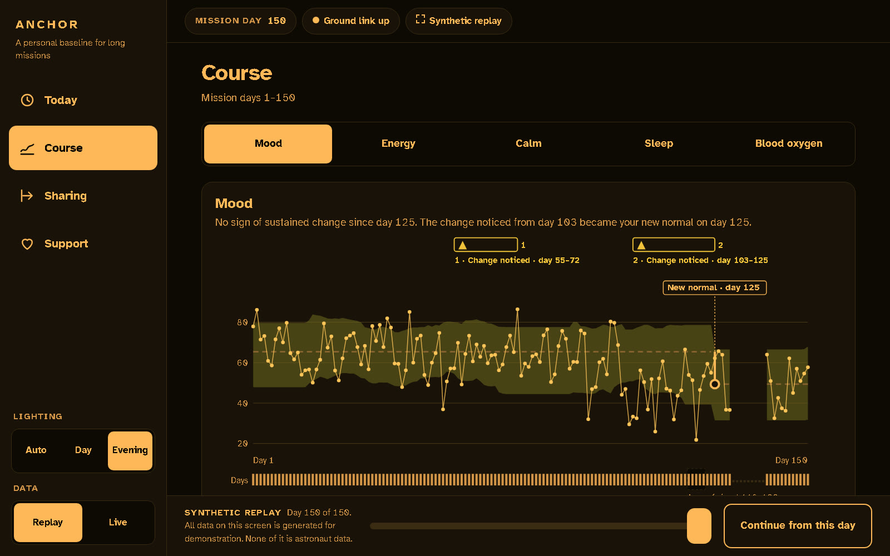
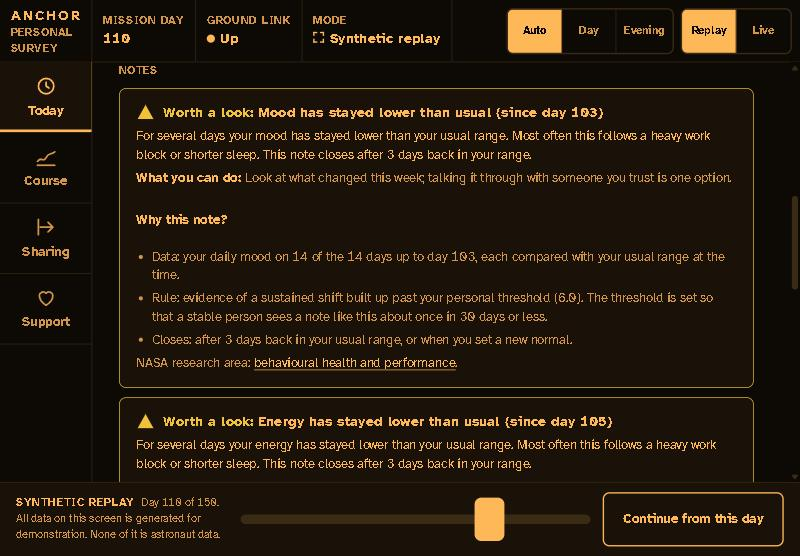
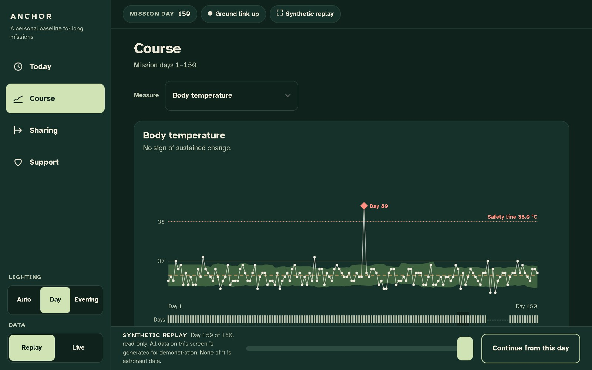

# ANCHOR: a personal baseline for astronaut wellbeing

**NASA Space Apps Challenge 2026 · Challenge: "Create Health Monitoring Software for Astronauts on Space Missions"**

**Live demo:** https://agcpr.github.io/nasa-space-apps-2026-anchor/app/ (a labelled synthetic 150-day mission; runs fully in the browser, offline after load)

In the replay, a short guide on the Today screen links straight to the three moments worth seeing.

**30-second demo video (4K, narrated):** https://agcpr.github.io/nasa-space-apps-2026-anchor/demo/anchor-demo.mp4

**7-slide deck (PDF):** https://agcpr.github.io/nasa-space-apps-2026-anchor/demo/anchor-deck.pdf

Direct links into the replay:
- [the personal range on day 150](https://agcpr.github.io/nasa-space-apps-2026-anchor/app/#view=course&day=150)
- [a note with its explanation, day 110](https://agcpr.github.io/nasa-space-apps-2026-anchor/app/#view=today&day=110&light=day&why=open)
- [the sharing log](https://agcpr.github.io/nasa-space-apps-2026-anchor/app/#view=sharing&day=150)

ANCHOR is a daily companion for long-duration crews. It learns each astronaut's own normal before flight, notices **sustained** change calmly, never diagnoses, and leaves the astronaut in control of what leaves the tablet. Pre-agreed safety lines still always work.



## Why it exists

NASA's Human Research Program lists the risks this tool addresses. The mapping, with sources, is in [docs/HRP_MAPPING.md](docs/HRP_MAPPING.md).

- **Behavioural health in isolation and confinement.** Long Mars communication delays weaken the ground support available on the ISS, and NASA names *privacy* as a top priority for crews' psychological well-being.
- **Sleep loss and irregular schedules.**
- **Mild hypoxia** in the partially depressurised cabins planned for exploration.
- **Cardiovascular adaptation, altered immune response, and food and nutrition**, covered by the morning measurements and their safety lines.
- **Teamwork** in small, isolated crews.
- **Systems that crews must run without mission control.**

## What it does

| | |
|---|---|
| **90-second evening check-in** | Three bipolar sliders (mood, energy, calm), rated *before* the astronaut sees any of their data: until the check-in is saved, only safety notices show. Sleep and SpO2 come from a wearable. |
| **Morning vitals** | Pulse, blood pressure, temperature and (every third morning) glucose, entered with large steppers. A stepper starts at the last reading but never saves it as today's unless the astronaut keeps it. Each of the nine measures has an "About this measure" card: how it is measured, why it matters in space, what helps. |
| **Personal range** | A Bayesian baseline anchored on pre-flight days. The band on screen holds about 8 in 10 days, and that claim was checked on real people (below). |
| **Calm by construction** | Sustained-change detection (CUSUM) with a calibrated false-alert budget: at most one unwanted note per 30 days, verified end to end at one per 39 days. No single-reading alerts except pre-agreed safety lines: one day's evidence is capped, so a single fever morning goes to the surgeon but never becomes a "several days" note ([ADR-0011](docs/adr/ADR-0011-single-day-cap.md)). |
| **"This is my new normal"** | The astronaut may accept a new level (reversible, at most once per 30 days, within 2 SD of pre-flight). It is drawn as a hinge in the range. |
| **Disclosure contract** | Private by default; sharing per category. Every share appears in a visible log *before* it is sent, recipients can be excluded without exception, and safety notices re-route to the CMO on board during loss of signal. |
| **Safety kernel** | Pre-agreed physiological lines, checked by two independently written kernels (Rust and TypeScript) with triple redundancy. A disagreement is recorded and treated as unconfirmed, never as "fine". |
| **"Why this note?"** | Every note shows its data, its rule, what would close it, and the NASA research area it relates to. |
| **Evening rendering** | Follows the ISS pre-sleep lighting: no colour bluer than 2700 K, checked by a test. |





## How it differs

A coded survey of 243 public repositories for this challenge (a reproducible keyword pass, with the nearest neighbours read in full; [LANDSCAPE.md](LANDSCAPE.md)) shows where ANCHOR departs from the field. The corpus is roughly a 10 % sample of the 2,407 registered teams.

| What most projects do | Share of the 243 | What ANCHOR does instead, and why |
|---|---|---|
| Collect mood data | 56 % | Detects *sustained* change in it against the person's own pre-flight range, under a stated false-alert budget. Statistical change detection appears in 5 %. |
| Report no false-alarm rate | 90 % | Reports it end to end (one note per 38.9 days against a budget of 30) and on real people (LifeSnaps), with an injected-change test. |
| Show a composite readiness or risk score | 12 % (28) | No composite score: each measure is shown on its own and explained, because a single number hides why it moved. |
| Offer a ground or mission-control dashboard | 29 % | None. Nothing leaves the tablet unless it is listed first. A pre-flight disclosure agreement with fixed safety lines appears in 0 of 243. |
| Leave wording unchecked (no calm-language design) | 99 % | Every sentence the astronaut can read passes a machine audit: no disease names, no alarm words, always an action and an owner. |

## Evidence

- **Real people, unmodified engine** ([docs/VALIDATION.md](docs/VALIDATION.md)). LifeSnaps: 71 adults, about 4 months of Fitbit and mood data, CC BY 4.0.
  - The 80 % personal range held **79 % (mood)** and **78 % (sleep)** of real days.
  - ANCHOR raised a sustained-change note about once per 95–125 days per indicator. A naive single-day 2 SD rule warned 2–6× as often.
  - 13,376 real records produced 0 errors, at 6.7 ms per record.
  - **Injected change:** a known, sustained change was injected into real sleep series (23 people). ANCHOR noticed a 1 SD drop within 4 weeks for 52 % of people, against 9 % by chance with nothing injected. The naive rule "noticed" 39 % by chance and raised five times as many notes beforehand (one per 45 days against one per 224).
  - **Finding:** for smoothed device signals such as Fitbit resting heart rate (lag-1 autocorrelation 0.87), the band is too narrow (58 %). Two fixes were tested and rejected with numbers (a conformal band, and removing the guard band). The band is now defined as a settled reference, and such signals are shown as trends only ([ADR-0010](docs/adr/ADR-0010-personal-range-semantics.md)).
- **Synthetic, end to end.**
  - 7,200 healthy person-days give one alert per 38.9 days, against a budget of 30.
  - A scripted 150-day mission demonstrates every mechanism. A Rust test fails if the demo stops demonstrating it.
- **Web quality (Lighthouse 12, live site, 14 Nov 2026).** Mobile: performance 98, accessibility 100, best practices 100, SEO 100. Desktop: performance 84, the other three 100. Total blocking time is 70 ms, because the demo mission is prebuilt by the engine instead of recomputed in the browser.
- **Independent implementations.** Python reference oracles and reference vectors cover numerics, baseline, detection and the safety kernel.
- **Tests.** About 70 automated tests across Rust, WebAssembly, TypeScript and the interface. They include a machine audit of every sentence the astronaut can read (no disease names, no alarm vocabulary, every message names an action and an owner), plus colour and contrast tests derived from NASA-STD-3001 Appendix F.

## How it works

```
check-in / wearable ──► hash-chained log (two copies, repairable) ──► engine (Rust → WebAssembly)
                                                                       ├─ safety kernel A  ─┐ compared at the
                                                                       │   kernel B (TS) ───┘ interface (N-version)
                                                                       ├─ personal baseline + CUSUM / drift
                                                                       └─ outbox: sharing log → transport
interface (vanilla TypeScript, SVG) = a projection of the log's outputs: replayable, auditable
```

- The engine is a deterministic fold over the log, so every screen can be reproduced by replay.
- The interface has no framework and no runtime dependencies. The WebAssembly boundary is a five-call hand-written ABI.
- Every design decision is argued, with alternatives, in an ADR: [docs/adr/](docs/adr/) (ADR-0001 to ADR-0011).

## Run it locally

```
python -m http.server 8765        # from the repository root
# open http://localhost:8765/app/
bash verify.sh                    # rebuilds and runs every check (needs Rust, Node 22, Python with numpy and scipy)
```

## Repository map

| Path | Contents |
|---|---|
| `core/` | Rust engine: log, safety kernel A, numerics, baseline, detection, outbox, demo mission |
| `wasm/` | WebAssembly boundary (the only crate with `unsafe`) |
| `kernel-b/` | Safety kernel B (TypeScript), independent of kernel A |
| `app/` | The interface (built output in `app/dist`, engine in `app/anchor.wasm`) |
| `oracle/` | Python reference implementations and test vectors |
| `analysis/` | Simulation studies, landscape survey, LifeSnaps validation scripts |
| `docs/` | ADRs, UI research, NASA HRP mapping, validation report |
| `DESIGN_PAPER.md` | Full design rationale with sources |
| `DESIGN.md` | Visual design system |

## Use of AI

This project was built with an AI coding assistant (Claude, by Anthropic) during the software phase. See [AI_ASSISTANCE.md](AI_ASSISTANCE.md) for what was assisted and how it was checked. Commits made with the assistant carry a `Co-Authored-By` trailer. No images are AI-generated. The demo video narration is synthetic speech (Kokoro open-weights TTS), disclosed on its end card and in the file metadata.

## Data, licences, credits

- **Demo data** is synthetic and labelled so on every screen. There is no astronaut data, no endorsement and no testimonial.
- **LifeSnaps** (Yfantidou et al., *Sci Data* 9, 663, 2022; CC BY 4.0). Used for validation only and not redistributed here.
- **Atkinson Hyperlegible** font, © Braille Institute of America, SIL Open Font License 1.1 (`app/fonts/OFL.txt`).
- **NASA sources** (HRP risk pages, NASA-STD-3001) are cited in [docs/HRP_MAPPING.md](docs/HRP_MAPPING.md) and [docs/UI_RESEARCH.md](docs/UI_RESEARCH.md). No NASA logos or insignia are used.

## Limitations

- **Not a medical device.** It informs and never diagnoses.
- **Not yet validated on astronauts or in spaceflight analogues.**
- **Placeholder screener wording.** The optional screener's item wording must be replaced with the licensed, validated instrument text before any use.
- **Browser storage is best effort.** A flight build would use a native shell (ADR-0009 §4).
