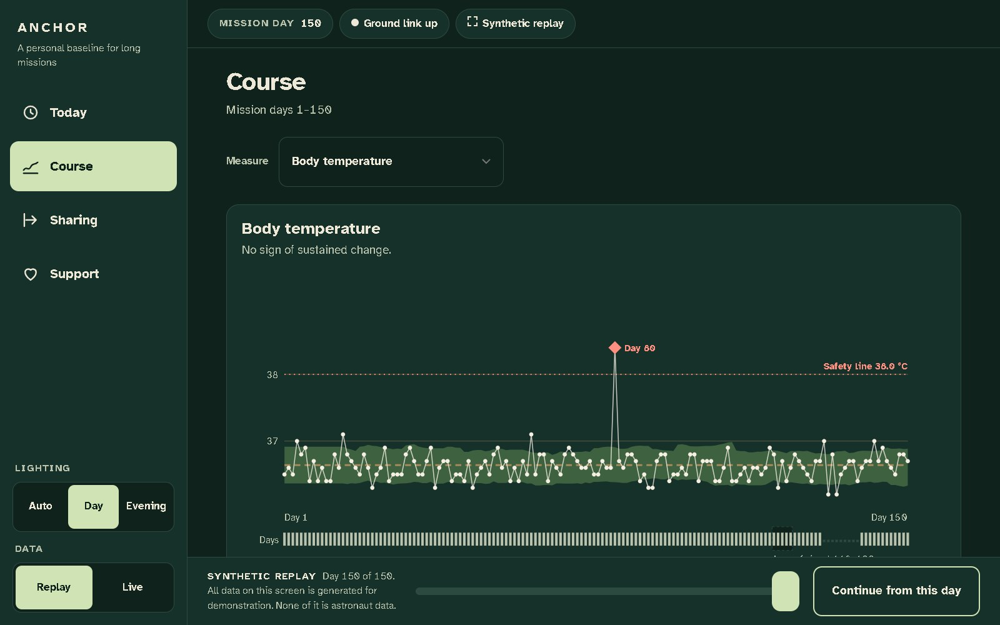

# ADR-0011: One day can never open a sustained-change note

**Status:** accepted · 14 Nov 2026 · amends ADR-0005 (detection)

## Context

ANCHOR's promise has two halves (DESIGN_PAPER F3, I3):
- **Single extreme readings** go to the safety kernel, against lines agreed before flight (ADR-0003). A 38.4 °C morning goes to the flight surgeon at once.
- **Sustained change** goes to the CUSUM detector, and the note says "over several days".

Adding the morning vitals (pulse, blood pressure, temperature, glucose) broke the second half. The plain CUSUM increment is $s\,z_t - k$, which is unbounded. A fever day has $z \approx 9$ on a person's temperature baseline, so one reading added about 8.5 to a statistic with a threshold $h \approx 4.5$. The result was a note that said "over several days" about a single morning. That note duplicated the safety line and was false in its own words.

## Decision

Cap one day's contribution (a Huber-type robust CUSUM):

$$S_t = \max\bigl(0,\; S_{t-1} + \min(s\,z_t,\, c) - k\bigr), \qquad c = 3.0,\; k = 0.5$$

- **One day adds at most $c - k = 2.5$.** `calibrate_bank` floors $h$ above 2.5, so at least two days of evidence are always needed. In practice the calibrated $h$ is 4.5–4.9 (demo mission), so about two extreme days or several moderate ones.
- **The cap is applied everywhere the statistic is computed:** `Cusum::step`, the Monte-Carlo calibration paths (`path_record`), the engine's provisional and "before" values, and the Python oracle (`oracle/detect_ref.py`). The reference vectors were regenerated. Calibration and detection therefore see the same statistic, and the false-alert budget still holds end to end (one note per 38.9 days against a budget of 30, N4).
- **$c = 3$ is chosen, not tuned.** For a 1 SD sustained shift, $P(z > 3)$ is about 2 %, so the cap almost never touches the days a CUSUM tuned to 1 SD is meant to accumulate. It only removes the leverage of outliers.

## Evidence

- **Unit test:** `a_single_extreme_day_never_opens_a_note` (z = 8 on one day: no note; a second such day: note).
- **Demo test:** the day-80 fever crosses the temperature safety line, reaches the surgeon, and produces no sustained-change note. The same holds for the day-120 SpO2 crossing.
- **Real data (LifeSnaps, docs/VALIDATION.md), before and after the cap:**

| | Before | After |
|---|---|---|
| Sleep notes, free-living | one per 104.4 days | one per 125.3 days |
| Mood notes, free-living | one per 94.5 days | one per 94.5 days |
| Injected change: noticed by chance (k = 0) | 13 % | 9 % |
| Injected change: noticed at 0.5 / 1.0 / 1.5 SD | 39 / 52 / 61 % | 39 / 52 / 61 % |
| Notes before the change | one per 179 days | one per 224 days |

The cap removed chance notes without losing any detection of a real sustained change.

## Consequences

- A truly abrupt and lasting change (a step of 5 SD) is noticed one day later than before: two capped days instead of one. Abrupt extreme values are the safety kernel's job, which reacts on the first reading.
- The coverage figures in ADR-0010 were measured before the cap. The band does not use the CUSUM statistic, but days inside an open note are not learned (`engine.rs`, learning gate). Fewer chance notes mean slightly more learned days, so sleep coverage moved from 0.782 to 0.784. The ADR-0010 comparison is unaffected because all its variants were run together.

## Sources

- Huber, P. J. (1964). Robust estimation of a location parameter. *Annals of Mathematical Statistics*, 35(1), 73–101.
- Lucas, J. M., & Crosier, R. B. (1982). Robust CUSUM: a robustness study for CUSUM quality control schemes. *Communications in Statistics – Theory and Methods*, 11(23), 2669–2687.
